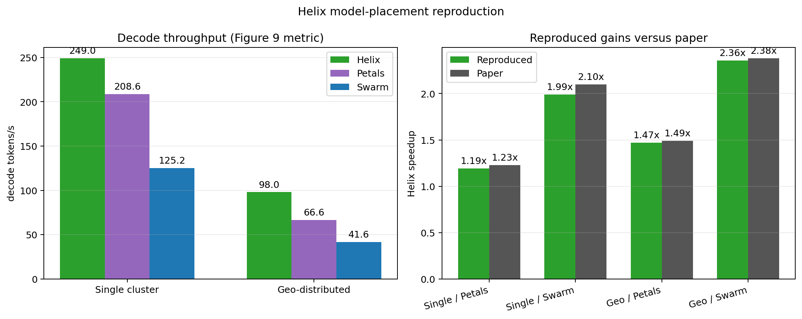

# Helix Artifact Reproduction on a Laptop

An educational reproduction of **Helix: Serving LLMs over Heterogeneous GPUs and Network via Max-Flow (ASPLOS 2025)** on an Ubuntu 22.04 WSL2 laptop. The work focuses on reproducible simulation, experiment debugging, log analysis and separating local measurements from upstream precomputed results.

[Detailed Chinese overview](README.zh-CN.md) · [Reproduction guide](docs/reproduction-guide.md) · [Evidence and limitations](docs/reproduction-status.md) · [Debugging log](docs/experiment-log.md)

## Reproduction scope

| Experiment | Evidence in this repository | Boundary |
| --- | --- | --- |
| Official tutorial, steps 1–3 | Cluster generation, placement and MaxFlow simulation | Simulator workflow |
| Figure 9: model placement | Local simulation logs, CSV and plots | No physical GPU cluster measurement |
| Figure 10: request scheduling | Local simulation comparisons | Workload/baseline settings are documented |
| Figure 11(a), 24 nodes | Local 60 s warmup + 600 s measurement | Reproduced on the laptop |
| Figure 11(a), 42 nodes | Diagnostic short run; upstream long-run values | 8 GiB WSL memory prevented the long run |
| Figure 11(b) and Figure 12 | Analysis of upstream solver traces | Solver was not rerun after the Gurobi license expired |
| Figures 6–8: physical deployment | Not reproduced | Requires multiple heterogeneous GPUs and network infrastructure |

This repository is a reproduction and analysis project, not the original Helix implementation or an original LLM-serving research contribution.

## Selected results



- **Figure 9, simulation:** Helix/Petals decode-throughput ratios are 1.19× (single cluster) and 1.47× (distributed); Helix/Swarm ratios are 1.99× and 2.36×. [CSV](results/figure9/summary.csv)
- **Figure 10, simulation:** MaxFlow decode throughput is 249.0 tokens/s in the single-cluster case and 99.8 tokens/s in the distributed case. These are simulator outputs. [CSV](results/figure10/summary.csv)
- **Figure 11(a), local 24-node simulation:** pruning gives 98.0 vs 74.9 decode tokens/s. The 42-node long-run row is explicitly sourced from the upstream artifact. [CSV](results/figure11/figure11a_throughput.csv)
- **Figure 12, upstream trace analysis:** the first optimal incumbent appears at 277 s; optimality is confirmed at 3,802.88 s. These are trace timestamps, not a fresh local solver run. [CSV](results/figure12/figure12_milestones.csv)

The [full Chinese overview](README.zh-CN.md) retains the original result discussion and all four figure previews. Results should be interpreted with the workload, hardware and provenance boundaries above.

## Reproduce the workflow

Upstream: [Thesys-lab/Helix-ASPLOS25](https://github.com/Thesys-lab/Helix-ASPLOS25), pinned to commit `8639497a4aaf1eb3b7594614cb0bbd376c1342b3`.

```bash
git clone https://github.com/Thesys-lab/Helix-ASPLOS25.git third_party/helix
cd third_party/helix
git checkout 8639497a4aaf1eb3b7594614cb0bbd376c1342b3
python3 -m venv .venv
source .venv/bin/activate
pip install -r requirements.txt
pip install -e .
export PYTHONPATH="$PWD"
cp ../../scripts/simulation/*.py examples/simulation/
cd examples/simulation
python step1_gen_cluster.py
python step2_model_placement.py petals
```

Follow the [reproduction guide](docs/reproduction-guide.md) for the remaining tutorial, figure runners and solver requirements. `environment/` records the original environment. Scripts under `scripts/analysis/` parse logs and traces; several require `HELIX_ROOT` pointing to the pinned upstream checkout. The source artifact and a valid solver license are separate prerequisites where applicable.

```bash
# Lightweight consistency checks on the committed result tables only:
python scripts/analysis/verify_published_results.py
```

The publication review checks table arithmetic and documented provenance. It does not rerun the distributed simulator or solver. Failed attempts, memory constraints and trace-only evidence remain documented rather than being replaced by success claims.

## Repository contents

- `scripts/simulation/`: adapted experiment entry points.
- `scripts/runners/`: repeatable experiment commands.
- `scripts/analysis/`: parsing, plotting and result checks.
- `results/`: aggregate tables, plots, local logs and exploratory comparisons.
- `docs/`: setup, debugging, methods and reproduction boundaries.

Some scripts adapt the Apache-2.0 upstream artifact. See [NOTICE.md](NOTICE.md) and [LICENSE](LICENSE) for attribution. The paper, original model weights and full upstream source are not redistributed.
