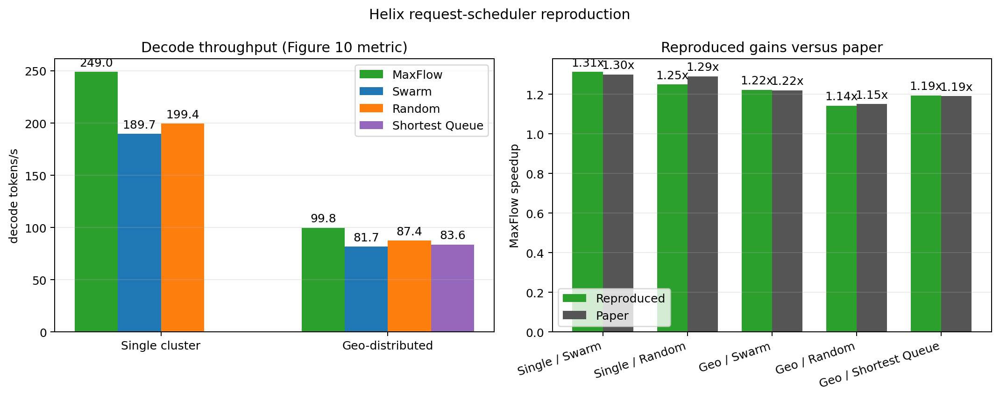
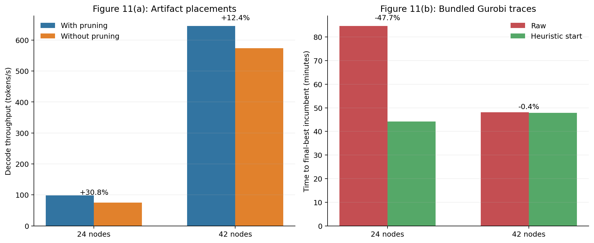
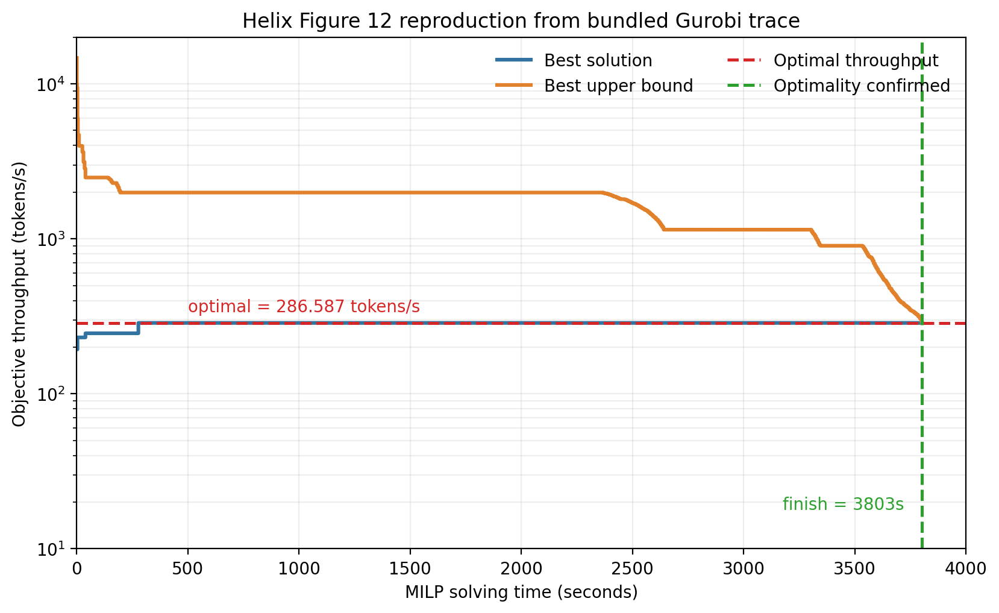

# Helix Artifact Reproduction on a Laptop

这是我作为 LLM serving / speculative decoding 初学者，在一台 Windows 笔记本的 Ubuntu 22.04 WSL2 环境中复现 [Helix (ASPLOS 2025)](https://github.com/Thesys-lab/Helix-ASPLOS25) artifact 的过程记录。

仓库重点不是宣称“复现了整篇论文的所有真实 GPU 实验”，而是完整记录：环境搭建、第一次运行、遇到的错误、修复过程、模拟器实验、结果分析，以及笔记本硬件带来的限制。

## 当前完成度

| 内容 | 状态 | 说明 |
|---|---|---|
| 官方教程 Step 1-3 | 完成 | 集群生成、模型放置、MaxFlow 仿真 |
| Figure 9 模型放置对比 | 完成 | Helix / Petals / Swarm |
| Figure 10 请求调度对比 | 完成 | MaxFlow / Swarm / Random / Shortest Queue |
| Figure 11(a) 24 节点剪枝 | 完成本机长跑 | 60 秒预热 + 600 秒测量 |
| Figure 11(a) 42 节点剪枝 | 部分 | 8 GiB WSL 内存不足，长跑采用官方 artifact 结果 |
| Figure 11(b) 初值消融 | 官方 trace 复现 | Gurobi 许可证过期，未重新求解 |
| Figure 12 解质量曲线 | 官方 trace 复现 | 自动解析官方 Gurobi trace |
| Figure 6-8 真实 GPU 系统 | 未完成 | 需要多台异构 GPU 和真实网络 |

完整边界说明见 [复现状态](docs/reproduction-status.md)。

## 主要结果

### Figure 9: Model placement


- Single cluster: Helix/Petals = 1.19x，Helix/Swarm = 1.99x。
- Geo-distributed: Helix/Petals = 1.47x，Helix/Swarm = 2.36x。
- 相对比例与论文接近，最大偏差约 5.3%。

### Figure 10: Request scheduling



- Single cluster: MaxFlow 249.0，Swarm 189.7，Random 199.4 tokens/s。
- Geo-distributed: MaxFlow 99.8，Swarm 81.7，Random 87.4，Shortest Queue 83.6 tokens/s。

### Figure 11: MILP ablation



- Table 8 变量规模下降：24 节点 36.34%，42 节点 46.45%。
- 24 节点本机剪枝实验：98.0 vs 74.9 decode tokens/s。
- 初值 trace：24 节点到达最终 incumbent 的时间减少 47.7%；42 节点附带 trace 中仅减少 0.4%。

### Figure 12: Model placement quality



- 277 秒首次找到最优布局。
- 3802.88 秒完成最优性证明。
- 复现“5 分钟内找到最优解，但证明最优需要超过 1 小时”的论文结论。

## 从零开始

实验固定到 Helix commit：`8639497a4aaf1eb3b7594614cb0bbd376c1342b3`。

```bash
git clone https://github.com/Thesys-lab/Helix-ASPLOS25.git third_party/helix
cd third_party/helix
git checkout 8639497a4aaf1eb3b7594614cb0bbd376c1342b3

python3 -m venv .venv
source .venv/bin/activate
pip install -r requirements.txt
pip install -e .
export PYTHONPATH="$PWD"

cp ../../scripts/simulation/*.py examples/simulation/
cd examples/simulation
python step1_gen_cluster.py
python step2_model_placement.py petals
```

逐步命令见 [复现指南](docs/reproduction-guide.md)，完整排错时间线见 [实验日志](docs/experiment-log.md)。

## 仓库结构

```text
.
├── docs/                 # 对话整理、复现步骤、排错和结果边界
├── environment/          # WSL/Python/依赖信息
├── scripts/
│   ├── simulation/       # 本次新增的仿真入口
│   ├── runners/          # 可重复执行的批处理脚本
│   └── analysis/         # 日志解析和绘图脚本
└── results/
    ├── figure9/          # 汇总、图表、CSV、原始日志
    ├── figure10/
    ├── figure11/
    ├── figure12/
    └── exploratory/      # 快速实验、负载扫描等中间探索
```

## 复现原则

- 不上传论文 PDF、个人周报、模型权重、虚拟环境和第三方完整源码。
- 对本机实跑、短时冒烟测试、官方预计算结果和官方 solver trace 作明确区分。
- 保留失败过程，例如 Python 导入错误、SSH 断连误判、进程检查和 42 节点 OOM 风险。
- 所有绝对路径统一写成 `$HELIX_ROOT`，避免暴露本机用户名。

## 上游与许可证

本仓库中的部分实验脚本基于 Helix 官方 artifact 脚本调整。Helix 使用 Apache License 2.0；详见 [NOTICE.md](NOTICE.md) 和 [LICENSE](LICENSE)。论文及原始实现的版权归原作者所有。
